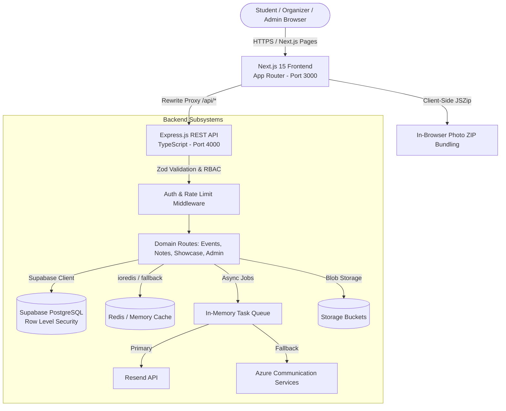

# CampusCoder — Student Coding Community Platform 🚀

[](https://nextjs.org/)
[](https://react.dev/)
[](https://www.typescriptlang.org/)
[](https://tailwindcss.com/)
[](https://supabase.com/)
[](https://expressjs.com/)
[](#-contributing-guidelines)
[](LICENSE)

**CampusCoder** is an end-to-end, production-ready developer community platform built for engineering colleges, universities, and student tech societies. It unifies event management, RSVPs with automatic transactional confirmations, browser-native bulk photo downloads, verified engineering study resources, student project showcases, and an administrative control panel with role-based access control.

---

## 📑 Table of Contents

- [🌟 Key Features](#-key-features)
  - [1. Student Portal](#1-student-portal)
  - [2. Admin Management Console](#2-admin-management-console)
  - [3. Backend & Email Pipeline](#3-backend--email-pipeline)
- [🏗️ System Architecture & Data Flow](#️-system-architecture--data-flow)
- [🛠️ Tech Stack](#️-tech-stack)
- [📁 Repository Structure](#-repository-structure)
- [🚀 Quick Start Guide](#-quick-start-guide)
  - [Prerequisites](#prerequisites)
  - [Step 1: Clone the Repository](#step-1-clone-the-repository)
  - [Step 2: Environment Variables](#step-2-environment-variables)
  - [Step 3: Database & Storage Setup (Supabase)](#step-3-database--storage-setup-supabase)
  - [Step 4: Install Dependencies & Run Development Servers](#step-4-install-dependencies--run-development-servers)
- [🧪 Testing & Quality Assurance](#-testing--quality-assurance)
- [🚢 Production Check & Deployment](#-production-check--deployment)
- [🤝 Contributing Guidelines](#-contributing-guidelines)
- [📜 License & Permitted Use](#-license--permitted-use)
- [👤 Author & Contact](#-author--contact)

---

## 🌟 Key Features

### 1. Student Portal
- **Events & Sprints Directory**: Filter and explore upcoming workshops, hackathons, coding challenges, orientations, and webinars.
- **Interactive Event RSVP**: One-click RSVP with duplicate prevention, capacity limits, and instant status reflection.
- **Event Photo Memories & Lightbox**:
  - Full-screen high-resolution photo gallery with keyboard navigation (`Left`, `Right`, `Escape`).
  - **Single Photo Download**: Instant download with event-specific file naming.
  - **Zero-Server Bulk ZIP Download**: Uses `JSZip` client-side to bundle high-res photo albums directly in the browser—saving server CPU and egress bandwidth.
- **Engineering Notes & Resources**: Curated course notes, interview preparation guides, university syllabus references, and cheat sheets.
- **Student Project Showcase**: Peer portfolio hub to showcase repositories, live demos, and technical writeups.
- **Authentication & Dashboard**: Supabase-powered authentication, email OTP verification, password recovery, and student profiles.

### 2. Admin Management Console
- **Event Lifecycle Management**: Create, edit, publish, or archive events with markdown support, banner images, and multi-speaker assignments.
- **Photo Gallery Management**: Batch upload high-resolution event photos to Supabase Storage or add direct URLs with immediate previews.
- **Meeting Link Broadcasts**: One-click broadcast of Google Meet / Zoom links with dynamically localized dates and times to all RSVP'd attendees.
- **Project Submission Review**: Triage student project submissions (Approve/Reject) with automated email feedback receipts.
- **Community Socials & Announcements**: Update campus announcements and manage links (Discord, WhatsApp, GitHub, LinkedIn).
- **Role-Based Access Control (RBAC)**: Enforces distinct authorization tiers (`student`, `organizer`, `admin`) via JWT session tokens and Row Level Security.

### 3. Backend & Email Pipeline
- **Type-Safe REST API**: Express.js with TypeScript and `Zod` schema validation on every endpoint.
- **Resilient Dual-Provider Email**: Primary transactional emails via **Resend** with automatic fallback to **Azure Communication Services**.
- **Asynchronous Queue Worker**: Concurrency-controlled, non-blocking queue (`backend/src/lib/queue.ts`) handling email dispatch with retry safeguards.
- **Fast Caching**: Redis-backed caching with automatic, transparent in-memory fallback when Redis is absent.
- **Secure Architecture**: Supabase secret keys remain strictly on the backend. The Next.js frontend proxies `/api/*` requests internally without leaking database credentials to browsers.

---

## 🏗️ System Architecture & Data Flow



---

## 🛠️ Tech Stack

| Category | Technology | Purpose |
|---|---|---|
| **Frontend Framework** | [Next.js 15](https://nextjs.org/) (App Router) | Server Components, SEO, Client UI, API rewrites |
| **UI Library & Styling** | [React 19](https://react.dev/) & [Tailwind CSS v4](https://tailwindcss.com/) | Modern responsive design & rapid styling |
| **Icons & Feedback** | [Lucide React](https://lucide.dev/) & [Sonner](https://sonner.emilkowal.ski/) | Clean iconography & toast notifications |
| **Client Bundling** | [JSZip](https://stuk.github.io/jszip/) | Client-side photo archive ZIP generation |
| **Backend Framework** | [Node.js](https://nodejs.org/) & [Express.js](https://expressjs.com/) | High-throughput REST API with TypeScript |
| **Validation** | [Zod](https://zod.dev/) | Strict runtime request schema validation |
| **Database & Auth** | [Supabase](https://supabase.com/) (PostgreSQL) | Managed PostgreSQL with RLS, Auth & Storage |
| **Large Object Storage** | Supabase Storage & Azure Blob Storage | Event galleries, banners, showcase artifacts |
| **Email Delivery** | [Resend](https://resend.com/) + Azure Communication Services | Transactional emails with React server templates |
| **Cache** | [Redis](https://redis.io/) (`ioredis`) | High-read caching with automatic in-memory fallback |
| **Testing** | [Vitest](https://vitest.dev/), [Playwright](https://playwright.dev/) | Unit tests, component tests, end-to-end testing |

---

## 📁 Repository Structure

```text
CampusCoder/
├── backend/                       # Node.js Express REST API (Port 4000)
│   ├── src/
│   │   ├── components/emails/     # React email templates (RSVP receipts, broadcasts, OTP)
│   │   ├── lib/                   # Email dispatchers, queue worker, cache, formatters
│   │   ├── middleware/            # Supabase JWT auth, RBAC guards, rate limiting
│   │   ├── routes/                # API controllers (events, notes, showcase, admin, auth, upload)
│   │   ├── types/                 # Database types and interfaces
│   │   └── server.ts              # Express application entrypoint
│   ├── supabase/migrations/       # Numbered SQL migrations (RLS, schema, triggers, storage)
│   └── package.json
│
├── frontend/                      # Next.js 15 App Router Frontend (Port 3000)
│   ├── src/
│   │   ├── app/                   # App Router pages (events, notes, admin, dashboard, auth)
│   │   ├── components/            # UI components, layout, navbar, event photo gallery
│   │   │   └── events/            # EventPhotoGallery, EventPhotoLightbox
│   │   ├── lib/                   # API client, downloadZip, eventPhotos, validation
│   │   └── types/                 # Shared TypeScript interfaces
│   └── package.json
│
├── docs/                          # In-depth architectural & deployment guides
│   ├── api_reference.md           # REST API endpoint catalog and schemas
│   ├── architecture.md            # Subsystem workflows and design decisions
│   ├── aws-deployment.md          # Production AWS EC2 deployment walkthrough
│   ├── email_setup.md             # Resend & Azure Communication setup guide
│   ├── security_audit.md          # Security assessment & RLS audit report
│   └── supabase_setup.md          # Database initialization & migration guide
│
├── package.json                   # Root monorepo workspace scripts
├── LICENSE                        # CampusCoder Community & Source-Available License
└── README.md                      # Platform documentation
```

---

## 🚀 Quick Start Guide

### Prerequisites
- **Node.js**: `v20.0.0` or higher recommended (minimum `v18.18.0`)
- **npm** or **pnpm**
- **Supabase Account**: [supabase.com](https://supabase.com) (Free tier works great)
- **Resend Account**: [resend.com](https://resend.com) (Free tier)

---

### Step 1: Clone the Repository

```bash
git clone https://github.com/bharatbushan03/CampusCoder.git
cd CampusCoder
```

---

### Step 2: Environment Variables

#### Backend (`backend/.env`):
Create `backend/.env` (refer to `backend/.env.example` or root `.env.example`):

```env
# Server
PORT=4000
NODE_ENV=development
FRONTEND_URL=http://localhost:3000

# Supabase Credentials (Backend only — never expose to frontend)
SUPABASE_URL=https://your-project-ref.supabase.co
SUPABASE_PUBLISHABLE_KEY=your_supabase_publishable_or_anon_key
SUPABASE_SECRET_KEY=your_supabase_secret_or_service_role_key

# Email Dispatcher (Resend primary)
RESEND_API_KEY=re_your_resend_api_key
FROM_EMAIL=CampusCoder <onboarding@resend.dev>
ADMIN_EMAIL=admin@yourcollege.edu

# Azure (Optional: fallback email & storage)
# AZURE_COMMUNICATION_CONNECTION_STRING=endpoint=https://...
# AZURE_STORAGE_CONNECTION_STRING=DefaultEndpointsProtocol=https;...

# Redis Cache (Optional: falls back to in-memory if omitted)
# REDIS_URL=redis://localhost:6379
```

#### Frontend (`frontend/.env.local`):
Create `frontend/.env.local`:

```env
# Backend Internal URL (Used by Next.js server rewrites to proxy /api/* requests)
BACKEND_INTERNAL_URL=http://localhost:4000

# Public Site URL
NEXT_PUBLIC_SITE_URL=http://localhost:3000

# Public Backend URL (For direct large file uploads if needed)
NEXT_PUBLIC_BACKEND_URL=http://localhost:4000
```

> [!NOTE]
> The frontend does **not** consume Supabase keys directly. All database access and authentication validation are handled securely through the backend Express layer and Next.js proxying.

---

### Step 3: Database & Storage Setup (Supabase)

1. Open your **Supabase Dashboard** -> **SQL Editor**.
2. Run the SQL migration scripts in [backend/supabase/migrations/](backend/supabase/migrations/) in numerical sequence, starting with:
   ```text
   20260529000000_init_schema.sql
   ...
   ```
3. In **Storage**, create public storage buckets:
   - `event-banners`
   - `event-photos`
   - `project-submissions`
4. For step-by-step guidance, refer to [docs/supabase_setup.md](docs/supabase_setup.md).

---

### Step 4: Install Dependencies & Run Development Servers

From the root directory:

#### Option A: Running from Root (Recommended)
```bash
# Install root & frontend dependencies
npm install

# Install backend dependencies
cd backend && npm install && cd ..

# Start frontend dev server (runs on http://localhost:3000)
npm run dev
```

In a second terminal, start the backend dev server:
```bash
cd backend
npm run dev
# Backend runs on http://localhost:4000
```

#### Option B: Independent Terminals
- **Terminal 1 (Backend)**: `cd backend && npm run dev`
- **Terminal 2 (Frontend)**: `cd frontend && npm run dev`

Open [http://localhost:3000](http://localhost:3000) in your browser to view the application.

---

## 🧪 Testing & Quality Assurance

Maintain code health by running tests and linters in order: `lint` -> `type-check` -> `test`.

```bash
# 1. Run frontend linter
npm run lint

# 2. Run frontend TypeScript type checking
npm run type-check

# 3. Run frontend Vitest unit & component tests
npm run test:unit

# 4. Run End-to-End Playwright tests (requires frontend & backend running)
npm run test:e2e

# 5. Backend verification (from backend directory)
cd backend
npm run lint
npm run type-check
```

---

## 🚢 Production Check & Deployment

Before committing or deploying to production, run the comprehensive verification check:

```bash
npm run production-check
```

This script validates:
1. Frontend ESLint checks
2. Frontend TypeScript compilation
3. Frontend Next.js production build (`output: standalone`)
4. Backend ESLint checks
5. Backend TypeScript type checking
6. Backend build (`tsc`)

For production deployment instructions on AWS EC2, Docker, or self-hosted environments, refer to [docs/aws-deployment.md](docs/aws-deployment.md).

---

## 🤝 Contributing Guidelines

We actively welcome contributions to make CampusCoder even better! Whether it is fixing a bug, adding new features, improving documentation, or refining UI components:

### How to Contribute

1. **Fork the Repository**: Create a personal fork on GitHub.
2. **Clone your Fork**:
   ```bash
   git clone https://github.com/<your-username>/CampusCoder.git
   cd CampusCoder
   ```
3. **Create a Feature Branch**:
   ```bash
   git checkout -b feature/amazing-feature
   # or
   git checkout -b fix/issue-description
   ```
4. **Make Your Changes**: Write clean, maintainable, and well-commented code following existing project patterns.
5. **Run Verification**: Ensure all linters and tests pass:
   ```bash
   npm run lint
   npm run type-check
   npm run test:unit
   ```
6. **Commit with Clear Messages**:
   ```bash
   git commit -m "feat: add filter for upcoming sprint workshops"
   ```
7. **Push to Your Fork & Open a Pull Request**: Submit your PR against the `main` branch of `bharatbushan03/CampusCoder` with a clear description of the problem solved.

---

## 📜 License & Permitted Use

This project is governed by the **CampusCoder Source-Available & Community Contribution License**.

### Summary of Terms:

- ✅ **Contributions Welcomed**: Anyone is welcome to fork, study, test, and contribute pull requests, bug fixes, features, and documentation to the official upstream CampusCoder repository.
- ✅ **Educational & Local Study**: You may clone, inspect, and run this project locally for personal learning and technical evaluation.
- ✅ **Contributor Attribution**: You may highlight your merged contributions to CampusCoder on your resume and portfolio.
- ❌ **NO Personal Project Claim / Plagiarism**: You **may NOT** copy, fork, or rebrand this codebase (in whole or in substantial part) to submit, display, or claim it as your own personal project, academic degree/capstone project, or personal portfolio creation.
- ❌ **NO Unauthorized Deployment**: You **may NOT** deploy, host, or run public or private production instances of this project for any institution, club, or organization under a different brand without prior written permission from the copyright holder.
- ❌ **NO Commercial Exploitation**: You **may NOT** sell, monetize, or charge fees for this software, its derivatives, or hosted versions.

For the full legal terms, please read the complete [LICENSE](LICENSE) file.

---

## 👤 Author & Contact

- **Created & Maintained by**: **Bharat Bushan**
- **Email**: [bharatbushan5320@gmail.com](mailto:bharatbushan5320@gmail.com)
- **GitHub**: [@bharatbushan03](https://github.com/bharatbushan03)
- **Official Repository**: [https://github.com/bharatbushan03/CampusCoder](https://github.com/bharatbushan03/CampusCoder)

If you find this project helpful, feel free to give it a ⭐️ on GitHub!
